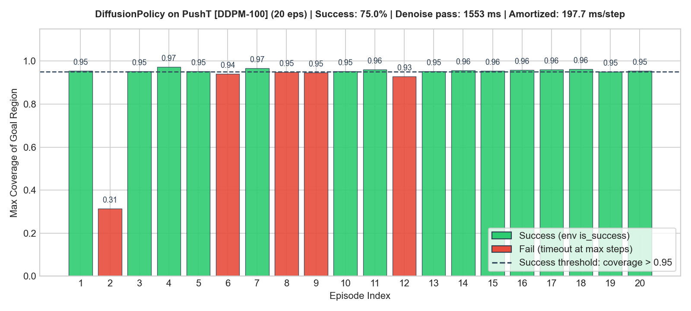

# lerobot-sim-eval-lab

Personal reproduction and evaluation scripts for HuggingFace LeRobot (`0.4.4`) on the PushT benchmark (`gym_pusht/PushT-v0`), tested on Windows 11 with an RTX 4070 Laptop GPU (`PyTorch 2.10.0+cu126`).

## Evaluation Results

Policy: `lerobot/diffusion_pusht` | Seeds: `1000–1019` (20 episodes, `max_steps=300`)

| Metric | Value |
| :--- | :--- |
| Success Rate (`terminated` or `max_reward >= 0.95`) | **90.0%** (18 / 20) |
| Mean Max Coverage Reward | **0.9674** |
| Mean Episode Length | **219.25 steps** |
| Mean Inference Time (CUDA) | **197.05 ms/step** |

Raw per-episode logs are in [`outputs/eval_report.json`](outputs/eval_report.json).

### Best vs. Hardest Rollout

Left: Episode 16 (`seed=1015`, 72 steps, reward `1.000`). Right: Episode 15 (`seed=1014`, 300 steps, max reward `0.553`).


### Per-Episode Max Reward



### Dataset Action Analysis (`lerobot/pusht`)

Analyzed the first 10 episodes (1,347 frames) from `lerobot/pusht` (stats in [`outputs/dataset_stats.json`](outputs/dataset_stats.json)):

- Action X: mean `232.44`, std `95.01`, range `[44.0, 511.0]`
- Action Y: mean `243.77`, std `83.86`, range `[56.0, 453.0]`
- Mean step displacement: `8.35 px/step`


## Note on LeRobot v0.3 -> v0.4 Compatibility

`lerobot/diffusion_pusht` on HuggingFace Hub was exported under LeRobot v0.3 and does not contain `policy_preprocessor.json`. Loading it directly with `lerobot==0.4.4` raises `FileNotFoundError` in `make_pre_post_processors`.

In `scripts/eval_pusht.py`, `_extract_legacy_stats()` reads the `normalize_inputs.buffer_*` and `unnormalize_outputs.buffer_*` tensors directly from `model.safetensors` and passes them as `dataset_stats` to reconstruct the v0.4 pre/post processors. See [`docs/setup_and_troubleshooting.md`](docs/setup_and_troubleshooting.md) for details.

## Reproduction

```powershell
# 1. Create Python 3.10 venv (using uv) and install dependencies
uv venv .venv --python 3.10
uv pip install --python .\.venv\Scripts\python.exe `
  --extra-index-url https://download.pytorch.org/whl/cu126 `
  --index-strategy unsafe-best-match `
  -r requirements.txt

# 2. Run 20-episode PushT evaluation
.\.venv\Scripts\python.exe scripts/eval_pusht.py --n-episodes 20

# 3. Plot dataset action trajectories & distributions
.\.venv\Scripts\python.exe scripts/visualize_dataset.py
```

Both scripts automatically fall back to `HF_ENDPOINT=https://hf-mirror.com` if direct HuggingFace Hub access fails.

## Files

```text
├── assets/
│   ├── pusht_comparison.gif
│   ├── eval_summary_chart.png
│   └── action_distribution.png
├── docs/
│   └── setup_and_troubleshooting.md
├── outputs/
│   ├── eval_report.json
│   └── dataset_stats.json
├── scripts/
│   ├── eval_pusht.py
│   └── visualize_dataset.py
├── requirements.txt
└── README.md
```
