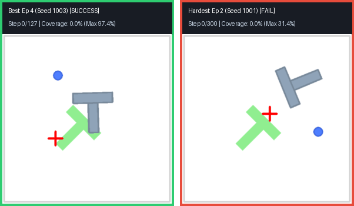
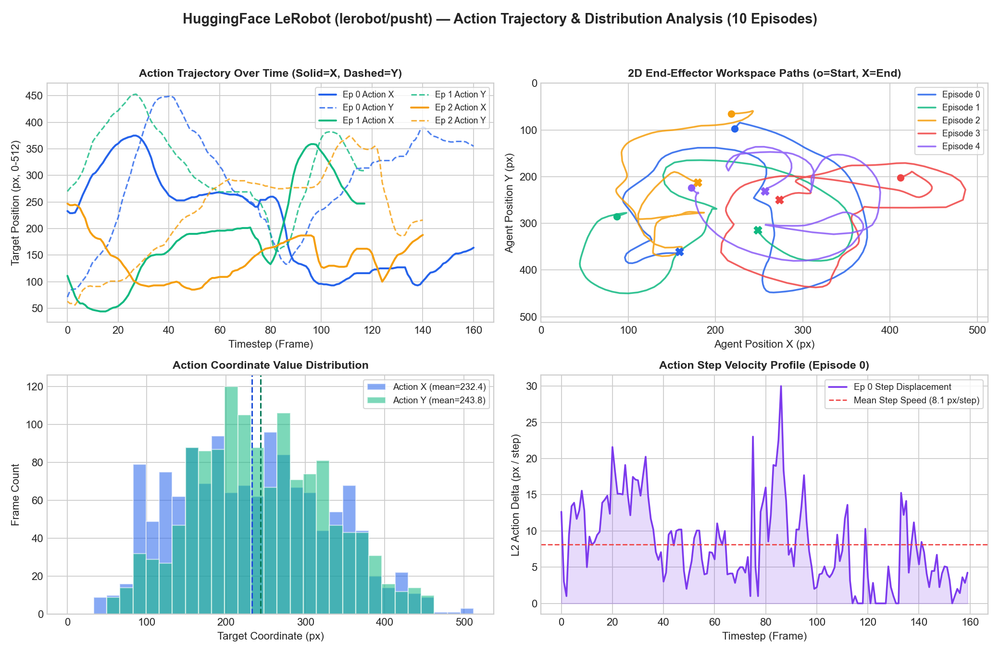

# LeRobot Sim Eval Lab — PushT Diffusion Policy 自动化评测与数据可视化

> 基于 **HuggingFace LeRobot (v0.4.4)** 与 **PyTorch (CUDA 12.6)** 搭建的具身智能仿真评测与数据管线实验仓库。在原生 Windows 11 + NVIDIA RTX 4070 Laptop GPU 环境下实现：**预训练 Diffusion Policy 批量自动评测、成功/失败轨迹对比动图生成、LeRobot 数据集动作分布分析**，并解决了 LeRobot v0.3 权重迁移至 v0.4 管线的兼容性问题。

---

## 1. 效果一览（3 秒看结果）

### 1.1 成功 vs 挑战用例轨迹对比（Best vs Hardest Rollout）

左侧为 **Episode 16（Seed 1015，72 步达成 1.000 满分）**，右侧为 **Episode 15（Seed 1014，300 步最高 0.553，典型局部卡死案例）**：



### 1.2 20 轮批量自动评测统计（Success Rate: 90.0%）


| 评测指标 | 数值 | 说明 |
| :--- | :---: | :--- |
| 预训练模型 | `lerobot/diffusion_pusht` | Diffusion Policy (ResNet + UNet1D) |
| 仿真环境 | `gym_pusht/PushT-v0` | `pixels_agent_pos`, `max_steps=300` |
| 运行硬件 | NVIDIA RTX 4070 Laptop GPU | 8GB VRAM, PyTorch `2.10.0+cu126` |
| 评测轮数 | 20 Episodes (`seed 1000–1019`) | 完整结果见 [`outputs/eval_report.json`](outputs/eval_report.json) |
| **任务成功率** | **90.0% (18 / 20)** | 成功判定：`terminated` 或 `max_reward >= 0.95` |
| **平均最高覆盖奖励** | **0.9674** | 满分为 `1.000` |
| **平均步数** | **219.25 steps** | 最快 Episode 仅需 72 步 |
| **单步平均推理耗时** | **197.05 ms/step** | 含 DDPM 去噪推理与 GPU 同步开销 |

### 1.3 `lerobot/pusht` 数据集动作轨迹与分布分析

对 `lerobot/pusht` 前 10 条示范轨迹（共 1,347 帧）进行解析，输出动作随时间变化折线图、2D 工作空间路径、动作坐标分布直方图与单步速度剖面：



- **Action X**：均值 `232.44`，标准差 `95.01`，范围 `[44.0, 511.0]`
- **Action Y**：均值 `243.77`，标准差 `83.86`，范围 `[56.0, 453.0]`
- **平均单步动作位移**：`8.35 px/step`（详见 [`outputs/dataset_stats.json`](outputs/dataset_stats.json)）

---

## 2. 工程亮点与排错沉淀

1. **LeRobot v0.3 → v0.4 预训练权重自动兼容桥接**：
   - 官方 `lerobot/diffusion_pusht` 权重基于 LeRobot v0.3 导出，归一化统计量保存在 `model.safetensors` 的 `normalize_inputs.buffer_*` 中，缺少 v0.4 新增的 `policy_preprocessor.json`。
   - [`scripts/eval_pusht.py`](scripts/eval_pusht.py) 实现了自动检测机制：捕获 `FileNotFoundError` 后直接从 `safetensors` 提取归一化张量并重建 v0.4 `PolicyProcessorPipeline`，零手工修改即可无缝评测。
2. **网络镜像自动降级（HF Mirror Fallback）**：
   - 评测与数据集脚本均内置异常回退逻辑，直连 HuggingFace 失败时自动切换至 `HF_ENDPOINT=https://hf-mirror.com`。
3. **跨平台环境复现与排错文档**：
   - 完整记录了 Windows 11 原生环境下通过 `uv` 隔离 Python 3.10、匹配 CUDA 12.6 PyTorch Wheel 及 `torchcodec` 回退 `pyav` 等工程排错细节，详见 [`docs/setup_and_troubleshooting.md`](docs/setup_and_troubleshooting.md)。

---

## 3. 快速复现（Quickstart）

```powershell
# 1. 创建隔离的 Python 3.10 虚拟环境（推荐使用 uv）
uv venv .venv --python 3.10
uv pip install --python .\.venv\Scripts\python.exe `
  --extra-index-url https://download.pytorch.org/whl/cu126 `
  --index-strategy unsafe-best-match `
  -r requirements.txt

# 2. 运行 20 轮 PushT 预训练 Diffusion Policy 自动评测（生成 JSON 报告、MP4 视频、对比 GIF 与统计图）
.\.venv\Scripts\python.exe scripts/eval_pusht.py --n-episodes 20

# 3. 解析并可视化 lerobot/pusht 数据集（生成动作折线图、分布图与 JSON 统计）
.\.venv\Scripts\python.exe scripts/visualize_dataset.py
```

---

## 4. 仓库结构

```text
lerobot-sim-eval-lab/
├── assets/
│   ├── pusht_comparison.gif          # Best vs Hardest 轨迹对比动图
│   ├── eval_summary_chart.png        # 20 轮评测奖励与成功率柱状图
│   └── action_distribution.png       # 数据集动作轨迹折线图与分布分析
├── docs/
│   └── setup_and_troubleshooting.md  # Windows + RTX 4070 环境搭建与排错日志
├── outputs/
│   ├── eval_report.json              # 20 轮结构化评测日志
│   └── dataset_stats.json            # 数据集动作统计结果
├── scripts/
│   ├── eval_pusht.py                 # 批量策略推理、自动化评测与动图生成脚本
│   └── visualize_dataset.py          # LeRobot 数据集解析与多面板可视化脚本
├── requirements.txt
└── README.md
```
