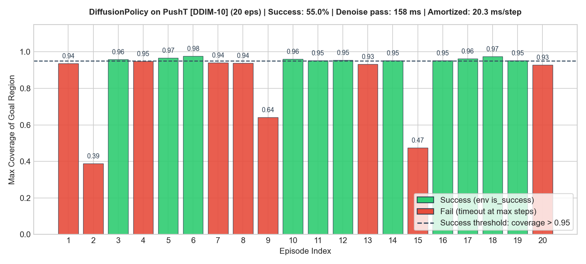

# lerobot-sim-eval-lab

Personal reproduction and evaluation scripts for HuggingFace LeRobot (`0.4.4`) on the PushT benchmark (`gym_pusht/PushT-v0`), tested on Windows 11 with an RTX 4070 Laptop GPU (`PyTorch 2.10.0+cu126`).

## Evaluation Results

Policy: `lerobot/diffusion_pusht` | Seeds: `1000–1019` (20 episodes, `max_steps=300`, `torch.manual_seed(seed)` per episode)  
Success criterion: environment `info["is_success"]` (`coverage > 0.95`).

| Sampler | Success Rate | Mean Max Coverage | Mean Steps | Full Denoise Pass (GPU) | Amortized Step Time | Raw Log |
| :--- | :--- | :--- | :--- | :--- | :--- | :--- |
| **DDPM-100** (default) | **75.0%** (15 / 20) | **0.9223** | 191.15 | **1553.28 ms** | 197.73 ms/step | [`eval_report.json`](outputs/eval_report.json) |
| **DDIM-10** (no retraining) | **55.0%** (11 / 20) | **0.8849** | 222.05 | **157.53 ms** (~9.9x faster) | 20.28 ms/step | [`eval_report_ddim10.json`](outputs/eval_report_ddim10.json) |

Notes on timing and trade-offs:
- `DiffusionPolicy` uses action chunking (`horizon=16`, `n_action_steps=8`): a full denoising pass runs once every 8 steps, while the remaining 7 steps pop cached actions (~0.2 ms).
- Switching to DDIM-10 cuts per-chunk denoising latency by ~9.9x (~1.55 s -> ~158 ms) without retraining, at the cost of lower terminal precision (6 of the 9 DDIM-10 failures reached 92.8%–94.9% coverage, just short of the 95% threshold).
- **Errata**: An earlier version of `eval_pusht.py` used `max_reward >= 0.95` (actually ~90.25% coverage because `gym_pusht` divides coverage by 0.95), which inflated v1's unseeded run from 65% (13/20) to 90% (18/20). See [`docs/errata.md`](docs/errata.md) for the full breakdown and archived v1 report.

### Best vs. Hardest Rollout (DDPM-100)

Left: Episode 4 (`seed=1003`, 127 steps, max coverage `0.974`, SUCCESS). Right: Episode 2 (`seed=1001`, 300 steps, max coverage `0.314`, FAIL).


### Per-Episode Max Coverage (DDPM-100 vs. DDIM-10)




### Dataset Action Analysis (`lerobot/pusht`)

Analyzed the first 10 episodes (1,347 frames) from `lerobot/pusht` (stats in [`outputs/dataset_stats.json`](outputs/dataset_stats.json)):

- Action X: mean `232.44`, std `95.01`, range `[44.0, 511.0]`
- Action Y: mean `243.77`, std `83.86`, range `[56.0, 453.0]`
- Mean step displacement: `8.35 px/step`


## Note on LeRobot v0.3 -> v0.4 Compatibility

`lerobot/diffusion_pusht` on HuggingFace Hub was exported under LeRobot v0.3 and does not contain `policy_preprocessor.json`. Loading it directly with `lerobot==0.4.4` raises `FileNotFoundError` in `make_pre_post_processors`.

In `scripts/eval_pusht.py`, `_extract_legacy_stats()` reads the `normalize_inputs.buffer_*` and `unnormalize_outputs.buffer_*` tensors directly from `model.safetensors` and passes them as `dataset_stats` to reconstruct the v0.4 pre/post processors. See [`docs/setup_and_troubleshooting.md`](docs/setup_and_troubleshooting.md) for details.

## Reproduction

```powershell
# 1. Create Python 3.10 venv (using uv) and install dependencies
uv venv .venv --python 3.10
uv pip install --python .\.venv\Scripts\python.exe `
  --extra-index-url https://download.pytorch.org/whl/cu126 `
  --index-strategy unsafe-best-match `
  -r requirements.txt

# 2. Run 20-episode PushT evaluation (default DDPM-100)
.\.venv\Scripts\python.exe scripts/eval_pusht.py --n-episodes 20

# 3. Run DDIM-10 speed/accuracy ablation (outputs suffixed with _ddim10)
.\.venv\Scripts\python.exe scripts/eval_pusht.py --n-episodes 20 --scheduler ddim --num-inference-steps 10 --tag _ddim10

# 4. Plot dataset action trajectories & distributions
.\.venv\Scripts\python.exe scripts/visualize_dataset.py
```

Both scripts automatically fall back to `HF_ENDPOINT=https://hf-mirror.com` if direct HuggingFace Hub access fails.

## Files

```text
├── assets/
│   ├── pusht_comparison.gif
│   ├── pusht_comparison_ddim10.gif
│   ├── eval_summary_chart.png
│   ├── eval_summary_chart_ddim10.png
│   └── action_distribution.png
├── docs/
│   ├── errata.md
│   └── setup_and_troubleshooting.md
├── outputs/
│   ├── archive/eval_report_v1_threshold_bug.json
│   ├── eval_report.json
│   ├── eval_report_ddim10.json
│   └── dataset_stats.json
├── scripts/
│   ├── eval_pusht.py
│   └── visualize_dataset.py
├── requirements.txt
└── README.md
```
